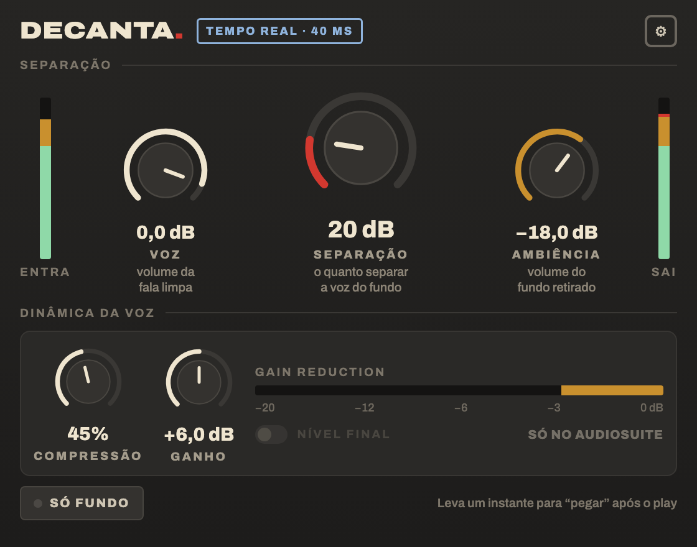

# Decanta Plugin

Limpeza de diálogo com [DeepFilterNet](https://github.com/Rikorose/DeepFilterNet), como plugin de áudio:
**VST3** (Premiere, Resolve…), **AU** (Logic) e **AAX** (Avid Media Composer e Pro Tools, inclusive AudioSuite).
Software livre, feito por um editor de vídeo para o dia a dia de montagem.



## O que ele faz

- **Separação**: o quanto separar a voz do fundo (limite de atenuação do DeepFilterNet, de 0 a 100 dB).
- **Voz**: volume da fala limpa.
- **Ambiência**: volume do fundo retirado. Voz e Ambiência no máximo devolvem o som original.
- **Compressão** e **Ganho**: compressor só na voz, para o fundo não subir junto. Os controles completos
  (Threshold, Ratio, Attack, Release, Knee) ficam na engrenagem ⚙.
- **Só fundo**: para ouvir o que está sendo retirado.
- **Limitador de proteção**: quando o volume é aumentado, a saída nunca passa de 0 dBFS.

No padrão (Separação 20 dB, Ambiência desligada, sem compressor), o som é **idêntico, bit a bit**, ao do
DeepFilterNet 0.5.6. Os testes automáticos conferem isso a cada mudança.

Funciona em qualquer taxa de 8 a 192 kHz. O modelo trabalha a 48 kHz e as outras taxas são convertidas.
O plugin informa o atraso ao programa (40 ms a 48 kHz), que o compensa.

## Instalar (macOS)

Baixe o pacote na página de *Releases* (ou nos artefatos da compilação) e copie:

| Formato | Pasta |
|---|---|
| `Decanta.vst3` | `~/Library/Audio/Plug-Ins/VST3/` |
| `Decanta.component` | `~/Library/Audio/Plug-Ins/Components/` |
| `Decanta.aaxplugin` | `/Library/Application Support/Avid/Audio/Plug-Ins/` |

Os plugins não são assinados pela Apple. Se o macOS bloquear depois de baixar, rode uma vez no Terminal:

```
xattr -dr com.apple.quarantine ~/Library/Audio/Plug-Ins/VST3/Decanta.vst3 ~/Library/Audio/Plug-Ins/Components/Decanta.component
```

O AAX só carrega no Avid se tiver a assinatura digital da PACE, uma exigência da Avid. As versões AAX
assinadas são publicadas por Danilo Lemos. Quem compilar o próprio AAX precisa da sua própria conta
de assinatura (gratuita) junto à Avid e à PACE.

## Como é feito

- `motor/`: o motor do app Decanta, em Rust (DeepFilterNet 0.5.6, leitura e gravação de WAV etc.).
- `ponte/`: o Decanta em tempo real e em clipe inteiro (separação, compressor, mistura, limitador e
  conversão de taxa), com uma interface em C para o plugin. `cargo test --release` roda os testes,
  inclusive a comparação bit a bit com o motor.
- `juce/`: o plugin, feito com JUCE 8. A janela é uma página HTML (`juce/ui/`), com a fonte Archivo.
  O `testa-plugin` passa um WAV pelo plugin compilado, ou abre a janela dele, para os testes.
- `mockups/`: os desenhos aprovados da janela.
- `test-audio/gravacao-teste-decanta.wav`: gravação de teste (diálogo com ruído).
- `scripts/atualizar-motor.sh`: atualiza a cópia do motor a partir do app Decanta.

### Compilar

Precisa de Rust, CMake e do [JUCE 8](https://github.com/juce-framework/JUCE) (8.0.9).

```
cmake -B build -S juce -DCMAKE_BUILD_TYPE=Release -DJUCE_DIR=/caminho/JUCE
cmake --build build --config Release --target Decanta_VST3 Decanta_AU Decanta_AAX
```

Para o Mac universal (Apple e Intel), use `-DDECANTA_UNIVERSAL=ON`. No Windows é preciso o WebView2;
veja `.github/workflows/plugin.yml`, que compila e testa Mac e Windows a cada envio.

Se a pasta do projeto tiver espaços no caminho, aponte a compilação do Rust para outra pasta
(`-DPONTE_TARGET_DIR=...`): a biblioteca de MP3 do motor não compila em caminhos com espaços.

## Licença

O plugin é distribuído sob a **GNU AGPL-3.0** (veja `LICENSE`), uma exigência do JUCE para projetos abertos.
O motor (`motor/`) e a ponte (`ponte/`) também podem ser usados sob MIT ou Apache-2.0.

Créditos: [DeepFilterNet](https://github.com/Rikorose/DeepFilterNet) (MIT/Apache-2.0),
[JUCE](https://juce.com) (AGPL-3.0), [rubato](https://github.com/HEnquist/rubato) (MIT),
fonte [Archivo](https://github.com/Omnibus-Type/Archivo) (OFL), funções matemáticas do
[musl](https://musl.libc.org) (MIT).
